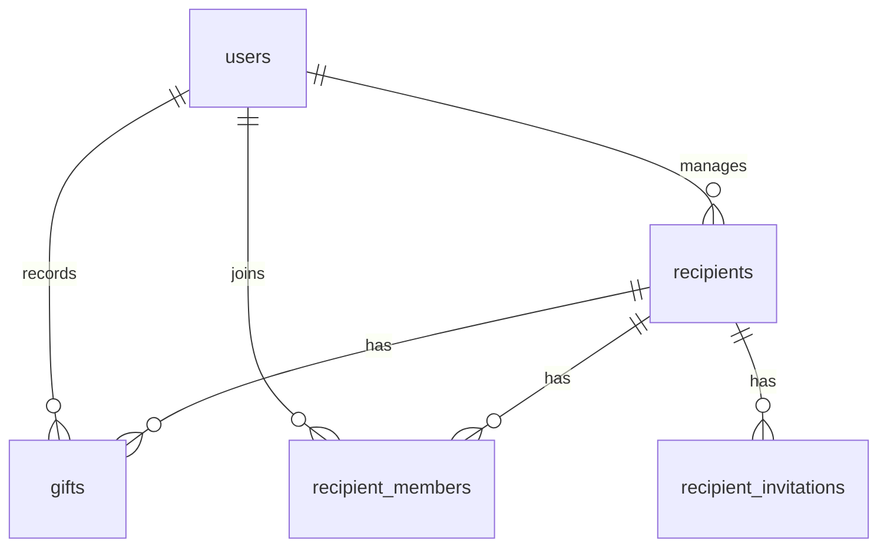

# Giftory 基本設計

## 技術構成

Laravel 13／PHP 8.3、Vue 3／Vite、公開用 MySQL、テスト用インメモリ SQLite。公開時は Vue と API を同一オリジンで提供し、Laravel のセッション Cookie と CSRF 保護を使用する。写真は非公開ストレージに保存し、API でアクセスを判定する。DB の時刻は UTC で保持し、贈った日の入力上限は日本時間の当日とする。

## ER図

| テーブル | キーと主な項目 | 制約 |
|---|---|---|
| users | id、name、email、password | email 一意。password はハッシュ |
| recipients | id、owner_id、name、relationship、preferences | owner_id は users を参照。好みは任意 |
| gifts | id、recipient_id、created_by、name、gifted_on、giver、reaction、photo_path、price、event | 外部キーは相手と登録者を参照。履歴用に (recipient_id, gifted_on, id) の複合インデックス。反応・写真・価格・イベントは任意 |
| recipient_members | recipient_id、user_id、joined_at | (recipient_id, user_id) 一意。現在の参加者を保持し、退出・解除で行を削除 |
| recipient_invitations | id、recipient_id、token_hash、expires_at、used_at、revoked_at | token_hash 一意。平文トークンは発行時のレスポンスだけに含める |

贈り物と参加者が0件の相手だけを削除する。贈り物・参加者の外部キーは相手の削除を制限し、招待は相手の削除とともに消す。参加者の解除・退出は贈り物と登録者を保持する。

## API

下記のパスは `/api` を付ける。認証が必要な読み書きは、常に要件定義書4.1の権限をサーバーで確認する。

| HTTP | パス | 用途 |
|---|---|---|
| POST | /register、/login、/logout | 会員登録・認証・セッション終了 |
| GET | /me | ログイン中の会員 |
| GET、POST | /recipients | 閲覧可能な相手の一覧・新規登録 |
| GET、PATCH、DELETE | /recipients/{recipient} | 相手の詳細・更新・削除 |
| GET、POST | /recipients/{recipient}/gifts | 履歴のページ取得・贈り物登録 |
| GET、PATCH、DELETE | /gifts/{gift} | 記録の詳細・更新・削除 |
| GET、PUT、DELETE | /gifts/{gift}/photo | 写真取得・差し替え・削除 |
| GET、DELETE | /recipients/{recipient}/members、/recipients/{recipient}/members/{user} | 参加者一覧・解除 |
| GET、POST、DELETE | /recipients/{recipient}/invitation | 有効な招待の期限確認・再発行を含む発行・無効化 |
| POST | /invitations/preview、/invitations/accept | 招待内容の確認・参加確定。トークンはリクエスト本文 |
| DELETE | /recipients/{recipient}/membership | 自分の参加を解除 |

未認証は401、閲覧権限のない対象は404、閲覧はできても操作権限がない場合は403、入力不備は422、現在の状態と衝突する操作は409を返す。

## 招待と共有の状態

招待リンクのトークンは URL フラグメントで受け取り、画面から API に渡す。発行・無効化・参加は相手行のロックを取ったトランザクションで処理する。有効な招待は1相手につき最大1件で、有効期限は発行から7日。参加時は期限・無効化・使用・既存所属を再確認し、メンバーの追加と使用日時の設定を同時に確定する。相手の削除・贈り物の追加・共有の変更も同じ相手行を基準に競合を制御する。

履歴の並び順は贈った日の降順、同日はIDの降順。記録変更は現在の閲覧権限と登録者IDの一致を確認する。写真の配信には `Cache-Control: private, no-store` を付ける。
